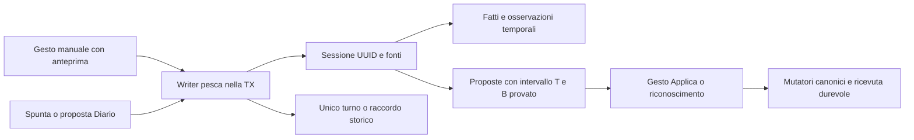

# L6 — A10 pesca: contratto tecnico integrale

## Stato, autorità e perimetro

Contratto del 21 ottobre 2026 per completare A10. Fonte dei requisiti: originali L6/L10 a `43ad8889`; base applicativa letta dopo I71, mantenendo congelata la consegna137. Il dossier [pesca-A10.md](pesca-A10.md) conserva la matrice delle fonti e il confronto con la situazione pubblicata.

**PASS di soluzione del revisore distinto `audit_documenti_originali`**, sul contratto in tre parti e sui delta conclusivi: comparsa/catturabilità/cattura separate; contesto storico e tentativi residui; protezione dei turni pregressi; intervalli del beneficio; fonti possedute; bonifica operativa atomica A02+A10. Questa trascrizione integrale deve essere riletta contro quel PASS. **Nessun PASS codice, runtime o consegna A10; nessuna attestazione esaustiva delle meccaniche controverse.** Non si dichiara completo tutto L6/L10.

Non si modificano diario validato, Kamoshida, Madarame o progressi personali per inizializzare il modello. Si mantengono le due chiavi attività; nessuna attività sostitutiva, fusione nominale o ripartizione dei vecchi contatori in catture. Schema e migrazioni sono proposti per la sequenza successiva a main137/utente28; il numero concreto sarà assegnato dal coordinatore prima dell'implementazione.

## 1. Requisiti e prove

| Fonte originale | Vincolo |
|---|---|
| R6-01b/02/03/06 | Fatti strutturati, riferimenti per chiave, combinazioni e valutatore unici; nessun requisito manuale libero |
| R6-18/19/21 | Prosa separata dalla formula; manifest esplicito; condizioni personali preservate |
| R10-01/02/05/20 | Effetti annullabili; un solo contatore per attività e turno distinto dall'esito |
| R10-10 | Doti solo proposte e applicate con gesto esplicito |
| R10-22 e M10§3.6 | Evento derivato posseduto rimosso quando si annulla la sua causa |
| R10-23/33 | Cestino; il dato cambiato dopo vince; nessun azzeramento dei progressi |

Fonti Royal lette:

- [Omoteura, Ichigaya](https://omoteura.com/persona5/the-royal/spot-ichigaya.html), §flusso97–99, tabelle106–134 e196–211: caso negativo della riscossione/ripresa; vie per specie e unità.
- [Wiki Royal, pesca](https://wikiwiki.jp/persona5r/%E9%87%A3%E3%82%8A),104–131: comparsa e cattura distinte, osservazione sul settimo tentativo anche dopo fallimenti.
- [AGS, pesca Royal](https://www.allgamestaff.it/persona-5-royal/pesca-laghetto-ichigaya/): confronto, con tensione interna già documentata. Non arbitra il conflitto fra tentativi e catture.
- [AGS, settimana32](https://www.allgamestaff.it/persona-5-royal/soluzione-settimana-32/): tutorial, senza trasformare l'itinerario in calendario universale.

Le fonti sono guide/osservazioni, non codice nativo decompilato. Si rappresenta l'ambito della prova. Una via sufficiente non viene negata per dichiarare impossibilità universale.

## 2. Innesti nel codice già esistente

| Codice letto | Capacità e limite |
|---|---|
| `attivitaService.ts:504–610` | `registraTurno`, `togliTurno`, `impostaVolteAttivita`: PK attività/ordine, contatore unico, promemoria Doti; manca UUID/risultato della visita |
| `effettiAzioneService.ts` | Ricevute legacy e una sola applicazione/annullo della porzione turni |
| `motoreDiario.ts:205+` | Transazione della spunta; filtro effetti canonici; provenienze e ricevute per generazione; nuovo effetto non deve richiamare due volte la closure legacy |
| `acquistiService.ts:97–162` | Anteprima CAS, writer transazionale, replay prima del CAS, fonti manuale/Diario; pattern da riusare senza inventare un acquisto pesca |
| `propostePartitaService.ts` e utente028 | Causa attualmente chiusa a acquisto/voce, attribuzioni provate, T−B, cicli e movimenti durevoli |
| `cestinoService.ts` | Cattura transazionale di entrambi i file e reverse; i durevoli non si ripristinano ciecamente |
| `pacchettoGiocoService.ts` | Riferimenti fra i file e orfani visibili; il pacchetto guida non contiene fatti personali |
| `disponibilitaService.ts` e `condizioni/valutatore.ts` | Un solo stato/valutatore; un Set booleano corrente non basta a ricostruire un fatto storico |

Il flusso è uno:



## 3. Schema scelto

### Dati guida, main

- `regola_pesca`: chiave stabile `ichigaya-royal-v1`, versione, dati/profili JSON strict, fonti/ambiti JSON, origine, seed_json, updated_at. Il profilo è la fonte unica modificabile della guida.
- `attivita.pesca_regola_chiave`: nullable, FK alla regola.
- `attivita.pesca_ruolo`: nullable, enum `visita|obiettivi`. A02 è visita; A10 presenta due obiettivi della stessa visita.
- Audit immutabile della bonifica con fotografie prima/dopo, due esiti e motivo del gruppo operativo.
- Nessun fatto personale nelle tabelle main.

### Dati personali, utente

| Tabella | Contratto |
|---|---|
| `turno_partita.uid` | Nuova colonna nullable UNIQUE. Le righe vecchie restano NULL; UID assegnato soltanto durante raccordo esplicito CAS, senza cambiare ordine/created_at/conteggio |
| `pesca_sessione` | UUID32, partita, attività A02 per chiave, momento immutabile, turno_uid/relazione, origineTurno, identita_json, creata_il |
| `pesca_osservazione` | UUID32, sessione, versione, dati JSON strict, precedente_id, creata_il. Correzione crea versione successiva, senza nuovo turno |
| `pesca_cattura` | UUID32, sessione, osservazione, specie `guardiano|boss|altro`, tentativo/posizione osservati nullable. Nessuna deduzione da rango o contatore |
| `pesca_provenienza` | UUID32, sessione, manuale/Diario, voce_uid/effetto_uid/generazione se Diario, operazione, fonte_json |
| `pesca_quota_storica` | Allocazione durevole di una sola quota già compresa nel contatore alla stessa sessione UUID; identità/firma della quota, non secondo contatore |
| `pesca_fatto_fonte` | UUID32, partita, evento canonico, valore, momento nullable, sessione/cattura nullable, fonte_json e operazione |
| `pesca_acquisto_esca` | UUID32, partita, momento, quantità effettiva, unità/costo punti pesca, fotografia identità e fonte; distinto da possesso/uso |
| `punti_pesca_partita` | Saldo osservato nullable, NULL=ignoto; nessuna inizializzazione dal vecchio costo1200 |
| `movimento_punti_pesca` | UUID, partita, proposta/operazione, prima/delta/dopo; durevole, anche rettifiche esplicite del saldo |
| `pesca_operazione` | PK partita/operazioneId, azione, payload/ricevuta JSON strict, data; replay immutabile prima del CAS |

Le fonti riferiscono la sessione per UUID e il Diario anche per UID effetto/versione/generazione. Le relazioni proprietarie della nuova famiglia hanno FK e controlli transazionali; le fotografie storiche e i riferimenti fra i due file sono validati dal dominio. Nessuna UNIQUE su giorno/fascia: non si inventa una quota giornaliera. Il legame al turno è unico per la sessione; il riuso di un numero d'ordine con UID diverso è conflitto.

Si estendono esplicitamente causa delle proposte a `pesca`, risorsa/unità a `punti-pesca`, vincoli e DTO di utente028. Non si usa un finto acquisto. `pesca_operazione`, movimenti, decisioni, cicli e ricevute sono durevoli nei restore parziali; un restore di partita comprende invece il blocco completo.

## 4. Identità, DTO e writer unico

### Input del contesto

- `MomentoPesca={giorno:MM-GG,fascia:giorno|sera,ordineVisita:intero>=0}`.
- `rangoPeriziaOsservato:1|2|3|4|5|null`, con provenienza `dichiarato|fotografia-corrente-confermata|ignoto`.
- `tentativiConsumati:number|null`; contesto del punto valutato: pianificazione oppure prossimo tentativo, con limite temporale/posizione osservata.
- `catture:[{id,specie,tentativo:number|null,posizione:number|null}]|null`. NULL=esiti ignoti, []=nessuna cattura dichiarata.
- `escaSpecialePosseduta:boolean|null`, `faseTerzoSemestre:boolean|null`, meteo e allerta osservati o ignoti.
- `quota:{pagata:boolean|null}`.
- `finale:{tipo:ignoto|uscita-dopo-riscossione|uscita-senza-riscossione,riscossioneUid:string|null,ripresaDopoRiscossione:boolean|null}`.
- `perizia:{esito:ricevuta|non-ricevuta|ignota}`.
- `fortuna:{giorno:MM-GG,attiva:boolean|null}`, con giorno uguale a quello della sessione.

Meteo/allerte usano gli enum già dell'app; nuvoloso, neve e gelo non diventano equivalenti. Il rango osservato è distinto dal beneficio Perizia. Un dato storico non dichiarato resta ignoto; il rango odierno non viene usato per ricostruirlo.

### Richiesta

`NuovaSessionePesca={operazioneId,momento,fonte,scelta,turno,osservazione}`:

- fonte manuale, oppure Diario con voceUid/effettoUid e proprietà verificata dal motore;
- scelta `nuova` oppure `collega(sessioneId)`;
- turno `nuovo`, `esistente(ordine,firmaTurno)`, oppure `contatore-storico(firmaContatore)`;
- conferma aggiunge `revisionePescaAttesa`.

Tutti gli oggetti, anche annidati, sono strict: nessuno strip di campi ignoti. L'anteprima mostra la forma normalizzata firmata dal CAS. Una sessione esistente si collega per UUID e confronto integrale momento/identità/osservazione; mai per nome, indice o somiglianza. Correzione di osservazione usa versione+CAS e mostra tutte le fonti coinvolte. Identità/momento non si spostano di nascosto.

`registraSessionePescaNellaTransazione` è l'unico writer. Nuovo turno: mutatore canonico una volta, con `doti=[]`; niente premio generico. Raccordo: nessun incremento. Prima di scrivere verifica tutti i token della richiesta/gruppo. Receipt completa costruita nella TX; un successivo errore di refresh non viene presentato come mancata creazione.

Il CAS comprende schema e RAW di regola/attività/sede, contesto osservato, sessione/revisioni/fonti, turno UUID e contatore, spunte/receipt della generazione, fatti temporali, decisioni/saldi e operazioni. Nessun GET muta o riconcilia dati.

## 5. Conto e proprietà dei turni

| origineTurno | Effetto della registrazione | Rimozione del solo dettaglio pesca |
|---|---|---|
| creato | Il writer pesca crea il turno e incrementa una volta | All'ultima fonte può togliere QUEL turno e decrementare una volta |
| raccordato | Si collega un turno preesistente dopo firma/ownership complete | Non toglie né decrementa il passato; resta una relazione |
| quota-storica | Si materializza un dettaglio per una quota già compresa, senza incremento | Può togliere il dettaglio materializzato, senza decrementare il vecchio contatore; allocazione durevole non riutilizzabile da altro UUID |

Per la quota storica si verifica la parte del conto non già rappresentata da dettagli/prove esistenti. La vecchia quantità non prova date, specie, catture o premi. Se non c'è una quota libera provabile, 409; non si incrementa per aggirare il conflitto.

Undo/riduzione generici pregressi restano possibili e tolgono una volta il proprio turno secondo la vecchia fotografia. Un raccordo ora revocato è marcato orfano, senza ricreare il turno né cancellare osservazioni manuali indipendenti. Un turno nuovo posseduto dalla pesca richiede invece il gesto della sessione: il bypass generico risponde409.

Per la vecchia spunta, rimuovere la fonte Diario non significa rimuovere fonti manuali. Il trasferimento esplicito di una porzione legacy valida receipt/generazione e impedisce doppio turno/bonus; non attribuisce al dettaglio pesca la proprietà di un conteggio preesistente. Attribuzioni Dote già riconosciute si trasferiscono solo con prova completa, altrimenti restano da verificare.

## 6. Catture, fatti canonici e tempo

Eventi canonici proposti, per chiave:

1. `guardiano-ichigaya-catturato`;
2. `boss-ichigaya-catturato`;
3. `terzo-semestre-avviato`.

La famiglia EVENTI_STORIA viene riusata con fonti temporali dedicate. Non si persiste anche un booleano parallelo in `evento_storia_partita`. Le route/toggle generici richiedono il writer dedicato per queste chiavi, evitando bypass di provenienza.

Fonti sessione derivano da cattura/contesto esplicitamente osservati e provenienze attive; una dichiarazione manuale del solo fatto può essere senza data, senza fabbricare visita/turno. Boss non inizializza Guardian. Terzo semestre non deriva da Maruki, data selezionata o vecchia spunta. Osservare che il semestre è già in corso a un momento non ricostruisce la sua data iniziale.

La fonte usa `avvenuto|non-avvenuto|ignoto`. Assenza di fonte è ignoto. Fonti incompatibili allo stesso limite temporale richiedono chiarimento409; fonti riferite a tempi diversi possono essere coerenti. Guardian non ancora catturato al05-01 e cattura05-08 rimangono entrambe. Fonte positiva non datata non impedisce un negativo storico.

Il loader e il case `evento` dell'unico valutatore leggono la proiezione con esito/fonti, non il solo Set corrente. Comparazione con `ordineGioco` già dell'app, poi fascia, ordineVisita e posizione osservata. Gennaio viene dopo dicembre. Nessun confronto lessicografico MM-GG o retrodatazione da created_at.

Per Guardian precedente serve fonte attiva antecedente all'inizio della sessione. Stessa fascia senza posizione confrontabile resta ignota. Guardian prima nella medesima visita non è promosso a via Boss senza prova. Fonte non datata significa noto ora, passato non ricostruibile; i loader storici ricalcolano questa proiezione, senza ereditare il Set odierno tramite spread.

Una cattura osservata si conserva anche quando il profilo non ricostruisce tutte le condizioni, con diagnostica. Non diventa conferma di altri fatti. Revocare una fonte conserva le altre.

## 7. Matrice di disponibilità specifica

Il DTO distingue:

- comparsa documentata;
- catturabilità per una via sufficiente;
- percorso pianificabile oppure prossimo tentativo reale;
- cattura già osservata;
- necessità mancante documentata oppure dato/caso da verificare.

Esca speciale posseduta riguarda il tentativo di cattura, non la semplice comparsa. Le vie seguenti non sono negate per costruire soglie universali.

| Specie/contesto noto | Via documentata | Limite |
|---|---|---|
| Guardian, prima terzo semestre, notte normale | MAX, sei catture precedenti, settimo tentativo disponibile | Sei soli fallimenti hanno prova Wiki ma conflitto con Omoteura: da verificare |
| Guardian, prima terzo semestre, notte pioggia/neve | Comparsa iniziale; rango4 o5 è via sufficiente di catturabilità | Inferiore/ignoto non è impossibilità universale |
| Guardian, terzo semestre, giorno | Via condivisa con Guardian precedente; normale MAX+sei catture, maltempo comparsa iniziale e rango4/5 per tentare | Senza precedente cattura il conflitto resta visibile |
| Guardian, terzo semestre, notte senza Guardian precedente | Vie notturne come sostituto Boss | Con cattura precedente, sua ulteriore presenza non è presunta |
| Boss, terzo semestre, notte e Guardian precedente | Normale MAX+sei catture; maltempo comparsa iniziale con rango5 | Rango inferiore nelle vie anticipate resta da verificare |
| Altri casi, dati ignoti, solo gelo non correlato a neve | Da verificare | Nessuna equiparazione silenziosa delle allerte |

Per un prossimo tentativo reale servono rango storico e risorsa residua al punto: `rango+2-consumati>0`. MAX e consumati7 danno residuo0, anche con sei catture. La via normale al settimo richiede consumati6 e catture precedenti a quel punto. Catture successive non si prestano al passato; posizione ignota resta ignota.

Una specie già catturata prima del punto nella stessa sessione non produce un'altra via positiva. Una cattura successiva non blocca una valutazione precedente. Non si aggiunge una UNIQUE giornaliera. Pianificazione mostra il percorso condizionale documentato, senza dire che il pesce sia ora presente.

Le condizioni ordinarie del profilo usano il vocabolario unico. Nuova sola foglia `pesca-sessione` per osservazioni esca/tentativi/catture, grigia senza contesto. Nessun contatore attività vale come lanci/catture. Backend restituisce profili con necessità, vie, fonti e incertezze; FE non rivaluta. La disponibilità generale resta ingresso al laghetto, senza AND fra Guardian/Boss o un solo Perizia4.

## 8. Beneficio finale, unità e intervalli

Finale senza riscossione e Perizia ricevuta è contraddizione409. Una cattura o una riscossione precedente non attestano il beneficio finale. Finale ignoto non viene completato per inferenza; un'osservazione esplicita del beneficio è distinta dal dettaglio della sequenza.

Controesempio obbligatorio: cattura → riscossione → ripresa → uscita senza nuova riscossione. Cattura conservata; Perizia non ricevuta, target0. Nessun bonus dal numero di visite.

Una sessione ha una sola quota ingresso, esplicitamente pagata/non pagata/ignota. L'acquisto esca è un fatto separato e tipizzato in punti pesca; quantità, possesso e uso non vengono confusi. Non si crea un negozio fittizio.

Il target è intervallo `[Tmin,Tmax]`, con TmaxNULL=limite superiore ignoto:

| Osservazione | Target |
|---|---|
| Perizia ricevuta, Fortuna false | [2,2] punti interni |
| Perizia ricevuta, Fortuna true | [3,3] |
| Perizia ricevuta, Fortuna ignota | [2,3] |
| Perizia non ricevuta | [0,0] |
| Perizia ignota | [0,3] |
| Quota pagata | [-q,-q], q=3000 giorno/1000 sera |
| Quota non pagata | [0,0] |
| Quota ignota | [-q,0] |
| Costo esca effettivamente comprata | [-1200×quantità,-1200×quantità] punti pesca |
| Causa revocata/inattiva | [0,0] per l'attribuzione di quella causa |

`B` è la somma delle sole decisioni/trasferimenti provati. Se B<Tmin si propone solo Tmin−B; se Tmax finito e B>Tmax, solo Tmax−B; dentro l'intervallo nessuna nuova attribuzione/inversa e incertezza residua visibile. Fortuna true con B3 divenuta ignota conservaB3: nessuna inversa−1. Analoga tutela per quota/Perizia diventate ignote.

Applicare la base certa2 produce receipt con componente `base-certa`, non totale falso2. Se in seguito Fortuna è confermata, B2 produce solo+1. Se non confermata, nessuna seconda base. Decisioni scartate e cicli restano rispettati.

Causa `pesca` usa UUID sessione per quota/Perizia, UUID acquisto esca per punti. Si estendono saldi/DTO mostrando limiti e residuo, senza falsificare `dovuto`. `PortePropostePartita.applicaDote/applicaYen` rimangono canonici; si aggiunge `applicaPuntiPesca`.

Rettifica punti pesca: operazioneId+CAS, saldo precedente ancheNULL, nuovo saldo osservato e movimento rettifica. Non marca singole spese come già conteggiate, non modificaB, non resetta proposte. Quel riconoscimento richiede decisione sulla specifica causa. Saldo ignoto blocca Applica movimento, non il riconoscimento storico esplicito. Nessun saldo negativo; nessuna sottrazione automatica.

## 9. API, Diario e recupero

Tutte le rotte personali sono sotto `/api/partite/:id`.

| Metodo/path | Contratto |
|---|---|
| GET /pesca | Sessioni, fonti, conto distinto, profili e proposte; readonly |
| GET /pesca/sessioni/:sessione | Identità, osservazioni/revisioni e ricevute; anche orfana/inattiva |
| POST /pesca/anteprima; POST /pesca | Anteprima/conferma sessione. La conferma PUBBLICA accetta solo fonte manuale |
| POST /pesca/sessioni/:sessione/anteprima-osservazione; POST /pesca/sessioni/:sessione/osservazioni | Correzione versionata, stessa sessione/turno |
| POST /pesca/provenienze/:fonte/anteprima-rimozione; POST /pesca/provenienze/:fonte/rimozione | Rimozione della sola fonte, con effetti del gruppo mostrati |
| GET /pesca/fatti | Tre canonici, esito tri-stato, ogni provenienza e limite temporale |
| POST /pesca/fatti/:evento/anteprima; POST /pesca/fatti/:evento | operazioneId,valore,momento|null,nota facoltativa; conferma aggiunge CAS |
| POST /pesca/acquisti-esca/anteprima; POST /pesca/acquisti-esca | Acquisto effettivo tipizzato, non possesso |
| POST /pesca/punti/anteprima-rettifica; POST /pesca/punti/rettifica | Rettifica osservata del saldo, senza attribuzioni implicite |
| POST /pesca/sessioni/:sessione/anteprima-rimozione; POST /pesca/sessioni/:sessione/rimozione | Rimozione completa con tutte le fonti mostrate, Cestino e ricevuta |

Rimozioni di singole fonti dei fatti usano UUID, anteprima e conferma come le fonti di sessione, con discriminante tipo fonte validata; nessuna identità risolta solo da un numero main. Le decisioni restano quelle di `da-applicare`, estese alla risorsa punti pesca.

Prima POST persistita nel registro client: operazioneId, payload/token immutabili, partita/bersaglio originali. Replay stessoID/payload restituisce receipt prima del CAS; diverso409. Refresh non determina esito del salvataggio. Ricevute tardive/notifiche restano riferite al contesto originale.

`EffettoVoce` aggiunge pesca. La provenienza Diario è accettata solo dal motore con UID/versione/generazione. Una closure legacy per gruppo, pesca filtrata prima: nessun secondo turno o bonus. Nuova spunta riceve `pesche[]`, verifica tutti i token prima di mutare. Spunta già data non riesegue. Operazione precedente di una generazione annullata non autorizza una nuova spunta.

La prima spunta segue il confine I71: PUT senza retry; recupero readonly tramite ricevute di TUTTI gli operazioneId e identità della generazione. Non si promette replay dell'intero PUT. Raccordo di vecchia spunta è proposta esplicita sul singolo effetto, senza ricalcolo globale.

## 10. Undo, Cestino, import e orfani

Togliere la spunta rimuove soltanto le fonti possedute dalla sua receipt/generazione. Manuali restano. Ultima fonte rimuove il turno soltanto se creato/incrementato dalla sessione; il raccordo storico segue §5. Fatti ed eventi derivati perdono solo quella provenienza. Target della causa inattiva torna0 e propone inverse dei delta già attribuiti, senza muovere automaticamente Dote/yen/punti.

Nuovi tipi personali Cestino: `fonte-pesca|sessione-pesca|osservazione-pesca`, UUID originale e riferimento utente. La rimozione completa presenta tutte le fonti. Il registro cattura fatti, osservazioni, fonti, legami al turno e modifiche effettive del conto; conserva i durevoli correnti durante restore parziale.

Restore UUID/foto integrale identici non duplica; divergenza409. Nessun nuovo UID/ordine inventato per aggirare una collisione. Il dato successivo vince e una spunta annullata dopo non viene riattivata. Si ricalcolano saldi/proposte, non benefici. Restore partita verifica il blocco completo e saldi senza applicare delta.

Evento Storico marcato con causa/provenienza/receipt posseduta; annullo toglie esattamente l'evento derivato, senza toccare importati o ricreare eventi mancanti. Il ripristino confronta RAW integrali come I71.

Cancellare voce toglie le sue sole fonti nella TX. Eliminare/importare la guida conserva fotografie personali e orfani visibili; niente ricreazioni di attività/sessioni. Import di vecchie partite aggiunge schema, lascia vecchi UIDNULL, catture e osservazioni vuote. Il pacchetto guida porta regole/profili/collegamenti, non dati personali.

Snapshot vecchio senza i nuovi campi conserva il link corrente e valida il record finale. Se reintrodurrebbe metà vecchia soglia o costo1200yen, 409 con fotografia/bozza preservate. Rimuovere il collegamento è gesto esplicito; non un effetto collaterale del vecchio import.

## 11. Bonifica selettiva e firme pubbliche

Base pubblica acquisita con sola lettura `readonly:true,fileMustExist:true` del DB tracciato `pacchetto/gioco.db`, schema93, blobGit `a598803601eb03f2feb77f1ce0b447b339c3a602`. Nessun RAW live è usato come manifest. Le firme integrali sotto contengono i28campi reali, senza default retroattivi.

Trasformazioni successive ammesse e documentate:

-105 aggiunge quiz_jsonSQLNULL; modifica il solo lavoro-triple-seven;
-121 aggiunge catalogo_chiaveSQLNULL, senza identità catalogo per queste attività;
-124 porta soltanto A02 condizioni_json a RAW `[]`, con audit/dipendenze di sede/quartiere/invito verificate; non si accetta come equivalente una124 esclusa;
-135 aggiunge confidente_chiaveSQLNULL e bonifica Takemi, non le due righe pesca.

Prima del codice il manifest deve verificare ogni altro campo contro il pubblico, più le tre colonne aggiunte esattamenteNULL. A10 mantiene la sua formula pubblica prima della bonifica. Nessuna normalizzazione di JSON, apostrofi/spazi o testi per dichiarare identità.

**Gruppo operativo all-or-nothing:** entrambe PRIMA esatte, oppure una DOPO esatta e l'altra PRIMA. Incompatibilità/assenza/fotografia pertinente non riconosciuta di una riga esclude tutto il collegamento operativo. Schema/regola additivi non attivano da soli A10. Audit primaUPDATE, due esiti e motivo di gruppo distinti; nessun progresso/turno/spunta migrato.

Snapshot preesistenti/Cestino non si riscrivono. Baseline futura Ripristina è il DOPO corretto; vecchio errore solo nell'audit, non nuovo default ripristinabile. seed_jsonSQLNULL restaNULL, e il primo edit futuro fotografa il dopo corretto.

### Manifest pubblico93 integrale

```json
[
  {
    "chiave": "pesca-ichigaya",
    "ordine": 2,
    "nome": "Pesca al laghetto di Ichigaya",
    "tipo": "mini-gioco",
    "luogo": "Ichigaya, laghetto",
    "luogo_chiave": "ichigaya",
    "fascia": "entrambe",
    "costo": 3000,
    "sblocco": "6 luglio (evento con Ryuji), oppure leggendo il libro 'Vedetta lacustre'",
    "doti_json": "[{\"dote\":\"perizia\",\"note\":null,\"condizione\":\"1 punto Perizia per sessione in cui si cattura almeno un pesce (fonte non specifica se equivale a 1 nota)\"}]",
    "altri_effetti": "Numero di tentativi = Rango Perizia + 2. I pesci catturati fruttano da 20 a 5.500 punti (Covo dei Ladri) a seconda di specie/dimensione.",
    "regole": "Costo 3.000 yen di giorno, 1.000 yen di sera. Prima sessione: 7 Boilie piccole gratis + 3 Boilie medie a fine sessione. Si regola direzione/potenza/distanza del lancio, poi si mantiene l'icona del galleggiante nella zona rossa durante il recupero.",
    "premi": "Libro 'Lo zen della pesca' aggiunge mirino e Terzo Occhio per identificare pesci speciali.",
    "paga": null,
    "fonte": "https://www.allgamestaff.it/persona-5-royal/pesca-laghetto-ichigaya/",
    "verificato": 1,
    "sessioni": 1,
    "origine": "seed",
    "nascosto": 0,
    "seed_json": null,
    "updated_at": null,
    "condizioni_json": "[{\"tipo\":\"gruppo\",\"modo\":\"almeno-una\",\"condizioni\":[{\"tipo\":\"data\",\"dal\":\"07-06\"},{\"tipo\":\"lettura\",\"categoria\":\"libro\",\"chiave\":\"vedetta-lacustre\"}]}]",
    "sede_chiave": "ichigaya/laghetto-ichigaya",
    "effetti_json": "[]",
    "paga_yen": null,
    "paga_massima": null,
    "dettagli": "Come funziona: Costo 3.000 yen di giorno, 1.000 yen di sera. Prima sessione: 7 Boilie piccole gratis + 3 Boilie medie a fine sessione. Si regola direzione/potenza/distanza del lancio, poi si mantiene l'icona del galleggiante nella zona rossa durante il recupero.\n\nPremi: Libro 'Lo zen della pesca' aggiunge mirino e Terzo Occhio per identificare pesci speciali.\n\nAltri effetti: Numero di tentativi = Rango Perizia + 2. I pesci catturati fruttano da 20 a 5.500 punti (Covo dei Ladri) a seconda di specie/dimensione.\n\nNote sulle Doti: Perizia: 1 punto Perizia per sessione in cui si cattura almeno un pesce (fonte non specifica se equivale a 1 nota)",
    "tracciamento": "svolta"
  },
  {
    "chiave": "sfida-pesca-guardiano-ichigaya",
    "ordine": 3,
    "nome": "Sfida: Guardiano e Boss di Ichigaya",
    "tipo": "sfida",
    "luogo": "Ichigaya, laghetto",
    "luogo_chiave": "ichigaya",
    "fascia": "entrambe",
    "costo": 1200,
    "sblocco": "Guardiano: Perizia Rango 4; Boss: dopo cattura del Guardiano, Perizia Rango 5",
    "doti_json": "[]",
    "altri_effetti": null,
    "regole": "Richiede l'esca speciale 'Boilie sospetto' (1.200 punti). Il Guardiano compare al 7 tentativo in condizioni normali, ma gia al 1 tentativo con pioggia o neve di sera.",
    "premi": null,
    "paga": null,
    "fonte": "https://www.allgamestaff.it/persona-5-royal/pesca-laghetto-ichigaya/",
    "verificato": 1,
    "sessioni": 1,
    "origine": "seed",
    "nascosto": 0,
    "seed_json": null,
    "updated_at": null,
    "condizioni_json": "[{\"tipo\":\"dote\",\"dote\":\"perizia\",\"rango\":4}]",
    "sede_chiave": "ichigaya/laghetto-ichigaya",
    "effetti_json": "[]",
    "paga_yen": null,
    "paga_massima": null,
    "dettagli": "Come funziona: Richiede l'esca speciale 'Boilie sospetto' (1.200 punti). Il Guardiano compare al 7 tentativo in condizioni normali, ma gia al 1 tentativo con pioggia o neve di sera.",
    "tracciamento": "svolta"
  }
]
```

### DOPO letterali scelti

Seguono le righe complete proposte per il gate codice. Le colonne guida nuove non compaiono retroattivamente nella93. La fonte storica della riga resta; i profili mostrano le fonti Royal strutturate della regola. I testi attivi non mantengono punti del Covo o un bonus ambiguo come istruzioni correnti.

```json
[
  {
    "chiave": "pesca-ichigaya",
    "ordine": 2,
    "nome": "Pesca al laghetto di Ichigaya",
    "tipo": "mini-gioco",
    "luogo": "Ichigaya, laghetto",
    "luogo_chiave": "ichigaya",
    "fascia": "entrambe",
    "costo": null,
    "sblocco": null,
    "doti_json": "[]",
    "altri_effetti": null,
    "regole": "Tentativi della visita: rango Perizia osservato + 2. Quote d'ingresso: 3.000 yen di giorno, 1.000 yen di sera; un ingresso, una quota. Catture, punti pesca riscossi e beneficio finale sono osservazioni distinte. Il Boilie sospetto costa 1.200 punti pesca solo quando viene acquistato.",
    "premi": "Libro 'Lo zen della pesca' aggiunge mirino e Terzo Occhio per identificare pesci speciali.",
    "paga": null,
    "fonte": "https://www.allgamestaff.it/persona-5-royal/pesca-laghetto-ichigaya/",
    "verificato": 1,
    "sessioni": 1,
    "origine": "seed",
    "nascosto": 0,
    "seed_json": null,
    "updated_at": null,
    "condizioni_json": "[]",
    "sede_chiave": "ichigaya/laghetto-ichigaya",
    "effetti_json": "[]",
    "paga_yen": null,
    "paga_massima": null,
    "dettagli": "La visita si registra una volta sola. Una cattura non prova il riconoscimento finale: riscossione seguita da ripresa e uscita senza nuova riscossione può non dare Perizia. Il beneficio osservato è 1 nota (2 punti interni base); Fortuna confermata per la data della visita porta a 3. Con Fortuna ignota l'intervallo è 2–3, senza restituzioni presunte.",
    "tracciamento": "svolta",
    "quiz_json": null,
    "catalogo_chiave": null,
    "confidente_chiave": null,
    "pesca_regola_chiave": "ichigaya-royal-v1",
    "pesca_ruolo": "visita"
  },
  {
    "chiave": "sfida-pesca-guardiano-ichigaya",
    "ordine": 3,
    "nome": "Sfida: Guardiano e Boss di Ichigaya",
    "tipo": "sfida",
    "luogo": "Ichigaya, laghetto",
    "luogo_chiave": "ichigaya",
    "fascia": "entrambe",
    "costo": null,
    "sblocco": null,
    "doti_json": "[]",
    "altri_effetti": null,
    "regole": "Guardiano e Boss sono obiettivi della stessa visita. Esche, comparsa, possibilità di cattura e cattura osservata sono distinti. Il Boilie sospetto costa 1.200 punti pesca se acquistato; possesso e uso non registrano un acquisto. Le vie documentate e i casi non coperti si consultano nei profili per specie.",
    "premi": null,
    "paga": null,
    "fonte": "https://www.allgamestaff.it/persona-5-royal/pesca-laghetto-ichigaya/",
    "verificato": 1,
    "sessioni": 1,
    "origine": "seed",
    "nascosto": 0,
    "seed_json": null,
    "updated_at": null,
    "condizioni_json": "[]",
    "sede_chiave": "ichigaya/laghetto-ichigaya",
    "effetti_json": "[]",
    "paga_yen": null,
    "paga_massima": null,
    "dettagli": "L'ingresso dipende dal laghetto. I profili distinguono comparsa, catturabilità e tentativo residuo e indicano la fonte di ogni via. I ranghi 4 e 5 descrivono vie sufficienti documentate, non soglie necessarie universali. Il Boss non prova una precedente cattura del Guardiano. I turni storici rimangono tali e non diventano catture.",
    "tracciamento": "nessuno",
    "quiz_json": null,
    "catalogo_chiave": null,
    "confidente_chiave": null,
    "pesca_regola_chiave": "ichigaya-royal-v1",
    "pesca_ruolo": "obiettivi"
  }
]
```

La regola contiene i profili §7 e fonti/ambiti §1. Non contiene un giorno assoluto di apertura dedotto dall'itinerario, una soglia necessaria universale o eventi inizializzati. La sede resta fonte della disponibilità generale.

## 12. Reader, editor e responsabilità implementative

| Responsabilità | File/callsite da comprendere nello stesso intervento |
|---|---|
| Nucleo e schema | Nuovo shared/pesca.ts, pescaService/schema/route, migrazioni main/utente, regola e manifest pubblico, intervalli/cause proposte |
| Integrazione BE | attivitaService, disponibilitaAttivita/disponibilitaService, valutatore, effettiAzioneService/motoreDiario/giornataService, partiteService, storicoService, cestinoService, pacchettoGiocoService e catalogoService |
| Contratti comuni | shared/effettiVoce, propostePartita, types, condizioniSpillo, eventi; OpenAPI e validator strict |
| FE e client | AttivitaPage e attività nella sede/negozio; ModuloAttivita+ModuloCatalogo incluse condizioni possedute dal guscio; editor effetti/spunta; Progressi/DaApplicare/Cestino/registro client |
| Integrazione/rilascio | Coordinatore: numeri/index migrazioni, controlli globali e documenti Regia; revisore distinto: gate codice/runtime nei limiti assegnati |

Nomi di ownership operativa saranno assegnati dal coordinatore prima di editare file condivisi. Nessuno deve sovrascrivere il lavoro degli altri.

Il modulo mostra i campi incompatibili prima di normalizzarli, con gesto esplicito; non li nasconde per far passare il salvataggio. Reader costo usa l'unità typed; non formatta punti comeyen. Reader effetti mostra il beneficio condizionato finale, non «nessun effetto» generico o premio per ogni cattura. Progressi conserva ignoto distinto da falso e link alla fonte anche se eliminata.

R6-31 mantiene identità A10 e ricerca, mostrando fonte, profili e audit distinti; nessuna finta Conferma/Applica. Non si chiude A10 per il solo ingresso al laghetto.

## 13. Consegna e verifiche successive

Questa attività produce solo contratto e firme pubbliche, senza test, API writer, DB write, migrazioni locali, commit o push. La lettura pubblica non è una prova sui dati personali.

Prima di implementare: rilettura del contratto scritto e assegnazione ownership. Dopo implementazione: tre riesami propri e gate distinto sul codice/manifest; typecheck, lint e build integrati del coordinatore; rilascio e osservazione pubblicata. Nessun test da scrivere o eseguire.

Controesempi da coprire nel riesame: tentativo fallito≠cattura; stessa visita con più catture≠piùturni; riscossione/ripresa/uscita≠beneficio; B3+Fortunaignota≠inversa−1; turno storico raccordato≠turno nuovo posseduto; MAX+consumati7≠tentativo disponibile; cattura futura≠prerequisito passato; Boss≠Guardian implicito;1200punti≠1200yen; snapshot saldo≠costo già conteggiato; bonifica di una sola riga≠gruppo operativo valido.

## 14. Implementazione in corso e gate statici (21 ottobre, 21:12Z)

**Consegna23ottobre:** gate statici integrati, conservazione138/029 e browserreadonly hanno ricevuto PASS distinti. Il servizio è ripristinato dopo correzioni conservative della029 (tipoINTEGER del contatore e statisticheSQLite1..4 preservate). Il rilievo visivoA10-BR01 è corretto e osservato su91d12aa5/pipeline39865491697. Registro/fonte/editor caricano senzaerrori osservati, nessuna osservazione/premio inventati. Scritture,recupero e ripristino non esercitati; il PASS non copre ogni viewport o l'interoL6/L10. Le note cronologiche sotto non rappresentano lo stato corrente dei gate già acquisiti.

**Aggiornamento22ottobre:** nucleo e integrazione approvati staticamente da Galaxy dopo B01/B02; typecheck6151/lint38004/build84257 exit0. B01 uniforma turniA02/A10 e respinge altri turni; B02 distingue fonti non datate note ora dalla proiezione storica. Baseline preventiva finale137/28 acquisita readonly soltantoRAM e procedura approvata:95main/46utente, RAW target e DDL029 coerenti, Cestino4registri/1281passi/0pertinenti,dipendenza124valida. Pubblicazione in corso; confronto dopo138/029 e osservazione reale ancora aperti. Le note cronologiche sotto sono superate per questi soli esiti.

La soluzione è stata approvata dal revisore distinto sulle specifiche originali e sulle fonti della matrice. Questo paragrafo registra l'implementazione successiva: non sostituisce i requisiti né certifica la consegna.

- Migrazioni 138/029, manifest pubblico e mapping Cestino: PASS statico del revisore distinto. Aggiunte cinque citazioni Wiki per via, senza cambiare formule. Registri append-only aggiornati dopo il PASS; nessuna migrazione eseguita localmente.
- Guscio attività: fascia `entrambe` e sessioni `1` del DOPO restano salvabili; helper, moduli e condizioni sono stati riallineati al contratto. La scelta della fonte non elimina campi senza gesto esplicito.
- Quattro rilievi del revisore sul FE chiusi staticamente: fotografia completa delle fonti al consenso; revisione iniziale legata alla bozza; selettori condivisi; quantità e costo unitario/totale dell'esca dal DTO fotografato.
- Galaxy: PASS statico del frontend integrato contro gli originali. FE01 perdita delle bozze su rifiuto noto, FE02 collisione delle chiavi dei turni A02/A10 e FE03 recupero riuscito del proprio gesto chiusi mediante rilettura indipendente. Il successo del proprio ID conclude la bozza prima del refresh; altri ID e rifiuti non la concludono. Nessun nuovo invio automatico o replay della prima spunta. Il PASS non include il backend in lavorazione o il runtime pubblicato.
- Profilo: DTO del punto corrente e della pianificazione separati. Raccordo R6 con fonte e audit 138 distinto, senza fingere risolta la ricerca A10.
- Nucleo backend ancora in completamento: assorbimento storico provato e annullamento, conservazione/ripristino, fotografia completa del CAS, validazione dello snapshot storico, controllo della fotografia corrente del rango e uso del valutatore unico. Nessun PASS integrato anticipato.
- Primo diagnostico globale: typecheck e lint non verdi per errori backend comunicati al proprietario. Il lint mirato dei successivi quattro file FE modificati per la conservazione delle bozze è verde. I controlli finali integrati e la build sono ancora da acquisire; nessun test scritto o eseguito.
- Baseline 137/28 acquisita in sola lettura e soltanto in RAM: 46 tabelle utente, 95 guida, 998 voci Diario, 1912 pin e le due attività. Non contiene nuove osservazioni; nessun RAW personale, hash o copia DB salvato nel repository.

Restano obbligatori i gate del nucleo e dell'integrazione, i controlli finali, pubblicazione/pipeline, confronto conservativo e osservazione del servizio rilasciato. L6 e il mandato L5–L11 rimangono aperti.

